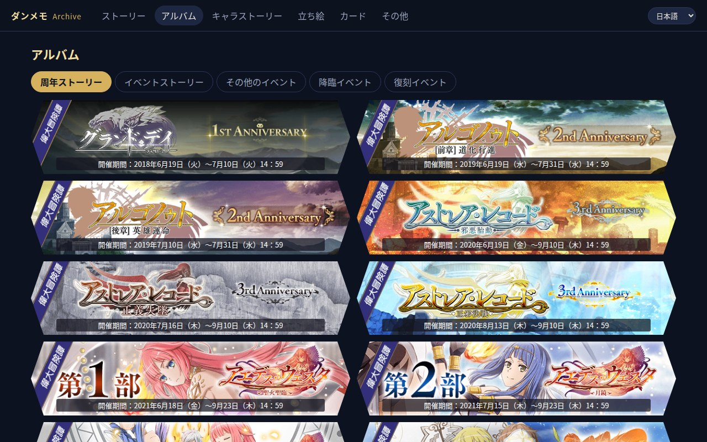
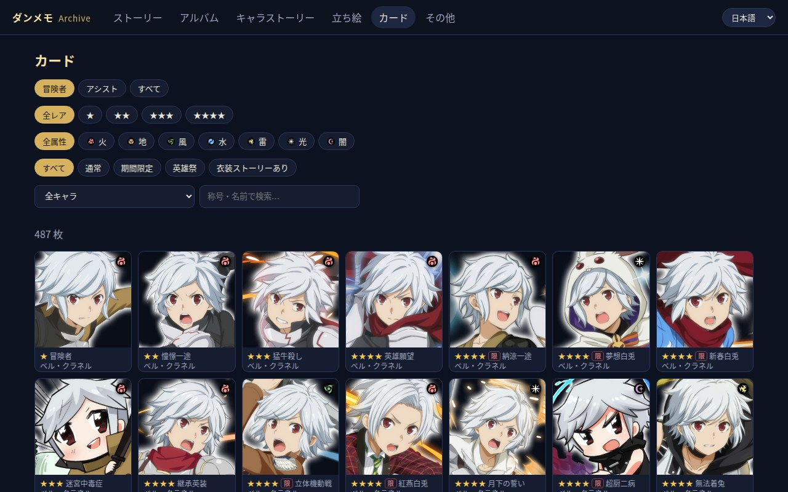
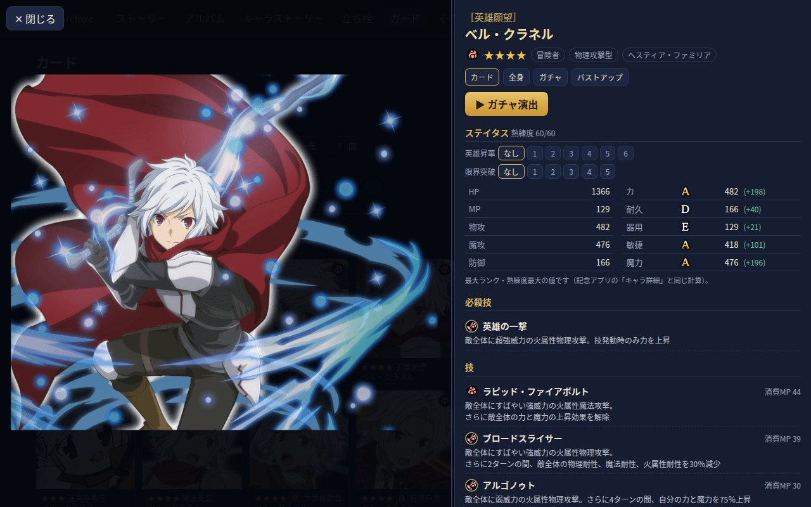

# DanMemo Archive Player

中文 | [English](README_EN.md) | [日本語](README_JP.md)

在電腦或手機瀏覽器上重溫《ダンまち〜メモリア・フレーゼ〜》（ダンメモ）的劇情：背景、立繪表情、語音、BGM、音效、LWF 特效、濾鏡、過場影片都能播放，另外有紀念版相簿（加上依開催期間補齊的活動）、角色劇情與語音、角色立繪、卡片鑑賞與抽卡演出，以及過場影片。

**本專案不含任何遊戲資源、解密後的資料或金鑰。** 所有素材都要由使用者用自己取得的檔案產生，只供個人觀看，請勿散布遊戲素材。

> 只有國際版 App 資料備份（英文劇情）的使用者，請看 [README_EN.md](README_EN.md) 的「Setup B」。

## 功能

- **ストーリー**：主線和其他沒有開催期間的劇情（栄光挑戦、教學等）。有開催期間的活動都在「アルバム」裡；同內容的復刻合併成一筆。
- **アルバム**：照紀念版 App 的「周年ストーリー／イベントストーリー」重現（48 篇，官方橫幅與開催期間），另加三個分頁：紀念版沒收、但有開催期間的「その他のイベント」「降臨イベント」，以及內容和初回不同的「復刻イベント」。
- **キャラストーリー（角色劇情）**：每個角色的服裝劇情、キャラクエ、ふれあい，以及個人資料和語音（登入、問候、觸摸、交流、城鎮、鬧鐘、換裝、系統；日版約 8,300 句）。
- **立ち絵（角色立繪）**：立繪與表情鑑賞。
- **カード（卡片）**：卡片能力值與抽卡演出（國際版資料用官方英文名牌；日版用舊版 APK 的清單可找回約 342 張官方名牌，由 `fill_gaps.py` 下載，其餘依稀有度配色自動產生；抽卡台詞是直書圖片，同樣由 `fill_gaps.py` 取得：日版約 281 張、國際版約 690 張）。
- **ムービー（影片）**：劇情裡的過場影片（例如 6 周年 SO12 的 7 支），可以單獨觀看，並連到出處劇情。
- **その他（其他）**：不在目錄裡的劇情片段；次回予告／據點劇情能對應到活動的放在該活動最前面，其餘依日期列在「拠点ノベル・予告」，動畫播出前的則依期數（2〜4 期）分開。
- 播放器：AUTO、SKIP（按住左 Ctrl 或切換）、LOG（可重播語音）、隱藏（隱藏對話框截圖用，H 鍵或右鍵）、設定（文字框顏色／不透明度、SKIP 間隔）、同一章節連續播放、已讀紀錄。
- 介面語言：中文／English／日本語，右上角切換，預設跟著瀏覽器語言。劇情文字維持建置時所用資料的語言。

## 畫面

| 相簿（官方橫幅與開催期間） | 卡片 | 卡片詳細與抽卡演出 |
|---|---|---|
|  |  |  |

畫面中的遊戲圖片版權屬於原權利人。本專案不附任何遊戲資料，以上內容都要用你自己準備的資料產生。

## Windows 版（不用安裝 Python）

到 [Releases](https://github.com/JalenLin/danmemo-archive-player/releases) 下載 `DanMemoPlayer-windows.zip`，解壓後執行 `DanMemoPlayer.exe`，在開啟的頁面選擇國際版 APK（或日版紀念版的 `.xapk`）並貼上解壓好的 App 資料備份資料夾，按「開始建置」即可。細節見 zip 裡的 `README.txt`。以下是用原始碼建置的步驟。

## Android 版

到 [Releases](https://github.com/JalenLin/danmemo-archive-player/releases) 下載 `DanMemoPlayer-android.apk` 安裝。需要 Android 7.0 以上的 64 位元手機。

有電腦的話，建議用「電腦打包」：不用把備份搬進手機，也不用在手機上建置。沒有電腦的話，照下面第 1〜3 步在手機上建置。

### 有電腦：電腦打包，手機直接播放

1. 在電腦上用 Windows 版建置完成後，按設定頁的「打包給 Android App」。
   - 用原始碼的話，執行 `python tools/dmpack.py`。
   - 會在 `DanMemoPlayer.exe` 旁邊產生 `DanMemo.dmpack`，裡面只有播放器和劇情用到的素材，例如國際版約 8.7 GB。
   - 打包要讀約 20 萬個檔案，Windows Defender 會逐一掃描。把 `work` 和備份資料夾都加入排除項目會快很多。
2. 把手機用 USB 接上電腦，選「檔案傳輸」，再把 `DanMemo.dmpack` 複製到手機內部儲存空間的 `DanMemo` 資料夾，直接放在資料夾裡，不要放進子資料夾。
   - 只有一個大檔案，所以很快：Pixel 10 Pro 約 2 分鐘。
3. 開啟 App，允許「管理所有檔案」，就會直接開啟播放器。

注意：
- 打包檔裡是你自己的遊戲資料，請只用在自己的裝置上，不要分享。
- App 只在啟動時尋找打包檔。如果複製時 App 開著，請完全關閉後再開。
- App 更新後，播放器程式會自動用新版，不用重新打包。只有在電腦上重新建置後（例如補下載素材），才需要重新打包。
- 放了打包檔，App 就不會再使用手機上的建置。要改回在手機上建置，把打包檔移出 `DanMemo` 資料夾即可。

以下是不用電腦、在手機上建置的步驟。

### 1. 把 App 資料備份放到手機

任選一種方式：
- **在手機上解壓**：把 RAR 分割檔放到手機上，例如 `Download/danmemo`，再用 RAR 或 ZArchiver 解壓。
  - 解壓期間，RAR 和解壓結果會同時存在，請準備約 30 GB 空間：分割檔約 11.5 GB，解壓後約 14 GB。
  - 解壓完成後可以刪掉 RAR。
- **在電腦上解壓**：解壓後再用 USB 把 `contents` 資料夾複製到手機。

這一步很花時間：在 Pixel 10 Pro 上實測**約 2 小時 10 分**（插電、螢幕亮著）。慢的原因是檔案**數量**，不是大小：備份有約 26 萬個檔案，Android 寫入共用儲存空間時，每個檔案都要經過系統的媒體處理。

加快的方法：
- 在系統設定裡，把解壓 App 的電池用量設為「**不受限制**」。新版 Android 在熄螢幕約 1 分鐘後，會把解壓 App 暫停。
- 讓螢幕**保持亮著**，解壓 App 留在前景；最好插著電。
- 暫停 Play 商店的自動更新：背景安裝 App 也會搶用媒體處理。
- 解壓前，先在目的資料夾放一個名為 `.nomedia` 的空檔案，避免相簿冒出數萬張遊戲圖片。

另外：
- 刪除解壓出來的資料夾同樣很慢，實測約 1 小時 40 分。除非要重新解壓，否則不必刪。
- RAR 會在原本是空的資料夾裡留下 0 位元組的 `.rartemp…` 檔案，不影響使用。

### 2. 建置

1. 開啟 App，依提示允許「管理所有檔案」。這是用來讀取備份資料夾，App 不會修改裡面的檔案。
2. 在設定頁選擇檔案：
   - **APK**：選國際版 APK，或日版紀念版的 `.xapk`。這個檔案會複製進 App。
   - **備份資料夾**：按「選擇資料夾…」，選解壓好的 `contents`，或包含它的上一層資料夾。這個資料夾不會被複製。
3. 可以勾選從遊戲 CDN 補下載缺少的素材，約 1.6 GB。
4. 按「開始建置」。不含補下載時約 15〜25 分鐘：Pixel 10 Pro 約 16 分鐘，Pixel 5 約 24 分鐘。
   - 這包括解密和轉換過場影片。App 內附精簡版 ffmpeg（LGPL），所以影片在手機上就能轉換。
   - 螢幕熄掉或切到背景時，建置仍會繼續，但新版 Android 會讓它慢很多。想快一點，就讓螢幕亮著、App 留在前景。
5. 顯示「完成」後，按「開啟播放器」。
   - 手機橫拿時，工具列會自動隱藏，點畫面最上緣可以叫出來。
   - 手機直拿時，工具列會分成幾行顯示。

### 3. 設定

- **語言**：設定頁和播放器共用同一個語言選單（日文、英文、中文）。
- **螢幕常亮**：在播放器的設定裡，可選「播放劇情時」（預設）、「一律」或「關閉」。

## 需要準備

- Python 3.10 以上；`ffmpeg`（只有轉換過場影片時需要）
- 日文版紀念 App（オフライン版，`com.danmemo`）的 APK，從**自己的手機**用 adb 取出
- 素材，任選一種（可以混用）：
  - 用 `tools/download.py` 從遊戲的 CDN 下載（約 11 GB）
  - 自己的 App 資料備份資料夾（`contents/1` … `contents/8` 這種結構）
- **建議**：8.x 以前（2019 年）的日版 APK。紀念版沒有的卡圖、抽卡演出、日文名牌和台詞、活動橫幅都靠它的清單取得（見第 5 步）
- （選用）國際版的 App 資料備份：補足紀念版和舊版都沒有的素材（會是英文版），或當作第二階段翻譯的對照

## 安裝

```bash
python3 -m venv venv
./venv/bin/pip install pycryptodome pyelftools numpy pillow
# 選用：playwright（自動測試）、capstone（分析 libapp.so 的工具）
```

## 步驟

### 1. 從手機取出 APK

在手機開啟 USB 偵錯，然後：

```bash
mkdir -p apk
for p in $(adb shell pm path com.danmemo | sed 's/package://'); do adb pull "$p" apk/; done
mkdir -p x/base x/pack x/lib
unzip -q apk/base.apk -d x/base
unzip -q apk/split_install_pack.apk -d x/pack
unzip -q apk/split_config.arm64_v8a.apk -d x/lib
```

### 2. 從自己的 libapp.so 產生金鑰

```bash
./venv/bin/python tools/keys.py x/lib/lib/arm64-v8a/libapp.so \
    x/pack/assets/master/divide_novel_command_enc/novelCommand751000001.enc
```

會產生 `keys.json`（不要分享這個檔案）。支援兩個版本，金鑰相同、日版和國際版資料都能解：紀念版 15.7.2 的 `libapp.so`，以及國際版 2023-12-22 的 APK（`com.eu.danmemo`，和社群資料備份一起分享的那份；直接給 `.apk` 檔即可，會自動取出裡面的 32 位元 `libapp.so`）。只有國際版備份的使用者不需要紀念版，見 [README_EN.md](README_EN.md)。

### 3. 設定

```bash
cp config.example.json config.json   # 依實際路徑修改
```

- `asset_roots`：素材根目錄，**越前面越優先**（每個根目錄底下是 `files/...`）
- `novel_dirs`、`master_dirs`：`.enc` 檔所在的資料夾
- `translations.en`（選用）：國際版的劇情與主資料，用於第二階段翻譯
- `manifests`、`legacy_manifests`：這套設定自己的素材清單（預設是 `cdn/` 裡的紀念版清單和 `cdn/legacy/`）。程式只讀這裡列的，不會自動用專案裡其他地方的清單
- `fallback_manifests`（選用，預設空）：用其他地區（例如國際版）的清單補缺。補進來的圖可能是那個地區的語言
- 想同時保留多套設定：各寫一個設定檔，用環境變數 `DANMEMO_CONFIG=路徑` 指定（每支工具都支援，也可以各自設定 `dec`、`web` 輸出位置）

### 4. 準備素材

```bash
# 方法 A：從 CDN 下載清單和素材
./venv/bin/python tools/fetch_manifests.py
./venv/bin/python tools/download.py
# 活動語音 zip 解壓（第 5 步的 fill_gaps.py 也會自動解開）
cd assets/files/sound && mkdir -p voice_episode && for z in voice_episode_zip/*.zip; do unzip -q -n "$z" -d voice_episode; done; cd -
```

方法 B：已經有 App 資料備份的話，把每個含 `files/` 的資料夾加進 `config.json` 的 `asset_roots`。

```bash
# 過場影片 USM → MP4（兩種方法都需要；fill_gaps.py 也會自動轉換它下載的影片）
for f in assets/files/movie/*.usm; do ./venv/bin/python tools/usm.py "$f" "${f%.usm}.mp4"; done
```

### 5. 解密、建置、啟動

```bash
./venv/bin/python tools/decrypt_all.py
./venv/bin/python tools/build_web.py
./venv/bin/python tools/legacy_manifests.py 舊版.apk  # 建議：8.x 以前（2019 年）的日版 APK，見下方說明
./venv/bin/python tools/fill_gaps.py
./venv/bin/python tools/build_web.py
./venv/bin/python tools/serve.py          # 開啟 http://localhost:8080/
```

紀念版沒有抽卡功能，清單也少了很多劇情用到的檔案。紀念版以外的日文素材都要靠舊版線上版：`legacy_manifests.py` 讀出 8.x APK 內附的清單網址（這些清單至今仍可下載），`fill_gaps.py` 再依清單下載卡圖、抽卡演出與語音、日文名牌與台詞、活動橫幅和劇情素材（影片會自動轉 MP4，活動語音 zip 會自動解開）。從零實測（2026-10）：

| | 只有紀念版 | 加 8.2.0 APK |
|---|---|---|
| 素材全部齊全的劇情 | 4,480 / 11,462 | 10,531 |
| 劇情頁橫幅 | 0 | 160 |
| 有卡圖／抽卡語音的卡片 | 8／42 | 297／281 |
| 官方名牌／抽卡台詞 | 108／75（2017 年快照） | 342／281 |
| 抽卡演出（動畫、開場影片） | 無 | 有 |

2019 年 9 月以後的卡片和活動只有國際版資料。要追求最完整（混用），有兩種做法，補進來的圖會是英文：
- 在 `config.json` 的 `fallback_manifests` 列出國際版的清單（例如國際版備份的 `contents/*/project.manifest`），`fill_gaps.py` 會依清單從 CDN 下載缺的檔案
- 或把國際版備份的資料夾直接加進 `asset_roots`（排在日版的後面），建置時就會直接使用

要讓同一個網路的手機觀看：`tools/serve.py 8080 0.0.0.0`，再用電腦的區網 IP 連線。

## 操作

- 點擊畫面、空白鍵或 Enter：下一句
- 按住左 Ctrl：快轉，放開就停；SKIP 按鈕切換快轉
- AUTO：自動播放（等語音結束）
- LOG：對話紀錄（再按一次或 Esc 關閉，可重播語音）
- 非表示／H／右鍵：隱藏對話框；點一下畫面恢復
- 設定：文字框顏色與不透明度、SKIP 速度
- Esc：回到目錄
- 已讀紀錄和設定存在瀏覽器裡

## 專案結構

```
tools/keys.py           從 libapp.so 推導金鑰
tools/dmcrypto.py       AES-256-CBC + zlib + XXTEA 解密
tools/fbdump.py         不需要 schema 的 FlatBuffers 解析器（含加密數值 int32／int64）
tools/decrypt_all.py    批次解密 → dec/（--lang en 解國際版 → dec_en/）
tools/build_web.py      產生 web/data/（劇情目錄、相簿、每段劇情、鑑賞資料）
tools/fetch_manifests.py 抓 CDN 的素材清單
tools/download.py       從 CDN 下載素材（續傳、MD5 驗證）
tools/legacy_manifests.py 從舊版（2019 年以前、舊制 CDN）APK 讀出遠端清單 → cdn/legacy/，供 fill_gaps.py 補日文原版素材
tools/fill_gaps.py      補下載劇情用到但手上沒有的素材（只用這套設定自己的清單：config 的 manifests、legacy_manifests 和備份內附的清單；其他地區的清單要寫進 fallback_manifests 才會用；已設定的素材目錄有的就不下載）
tools/config.py         讀取 config.json（或 DANMEMO_CONFIG 指定的設定檔）
tools/cardstat.py       卡片能力值計算（對照紀念版「キャラ詳細」畫面反推）
tools/download_extra.py 依清單格式的 JSON 下載額外素材
tools/usm.py            CRI USM → MP4
tools/gachanames.py     抽卡演出的名牌圖（build_web.py 會呼叫）
tools/serve.py          本機伺服器（支援 Range）
tools/launcher.py       Windows 版的啟動程式：瀏覽器設定頁、自動產生設定、依序建置、提供播放器（packaging/ 是打包設定）
android/                Android 版：Chaquopy 在 App 內執行 launcher.py，全螢幕 WebView 顯示設定頁和播放器；有打包檔時直接從打包檔提供播放器（pack_serve.py）
tools/dmpack.py         把電腦上建好的播放器和用到的素材打包成一個 .dmpack，給 Android App 直接播放
web/js/i18n.js          介面文字（日文為鍵 → 英文／中文）與日期格式
tools/smoke.py          播放器自動測試：以快轉模式播放劇情，回報卡住、指令錯誤、素材載入失敗（`smoke.py all --workers 10` 跑全部；Playwright；DANMEMO_URL 指定網址）
tools/vidcompare.py     對照原作錄影：逐句截圖播放器、和影片逐句對齊，列出畫面差異最大的句子（需要 ffmpeg、Playwright）
tools/shot.py           播放器截圖（同上）
tools/gdrive_ls.py / gdrive_get.py  列出／下載公開的 Google Drive 資料夾
tools/wayback_get.py    下載 Wayback Machine 收錄的日版公告圖與公告頁（研究用）
tools/elfre.py / reloc.py / novelcmd_map.py  分析 libapp.so 的小工具
web/                    播放器（純 HTML/JS，不需要建置）
docs/PROCESS.md         完整的分析與製作紀錄
README_EN.md / README_JP.md  英文／日文說明
```

## 授權

- 本專案程式：[MIT License](LICENSE)
- `web/vendor/lwf.js`：GREE LWF，zlib License（見 `web/vendor/LWF-LICENSE.txt`）
- 遊戲內容的著作權屬於原權利人
