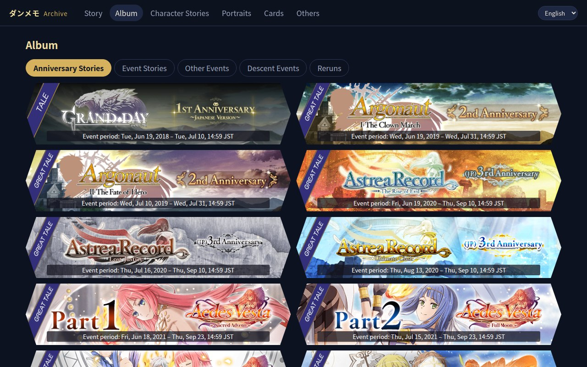
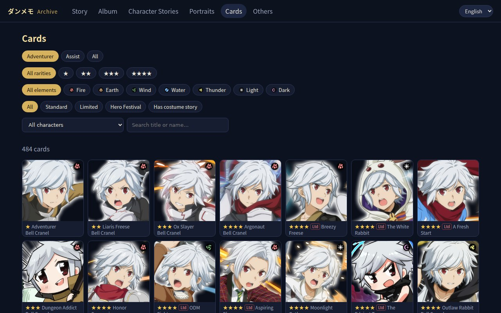
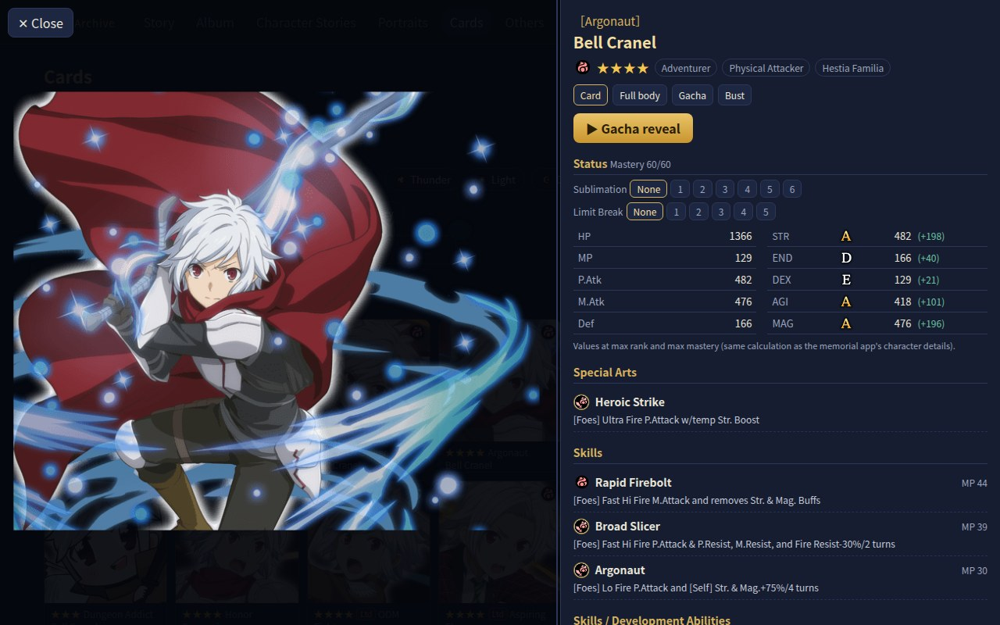

# DanMemo Archive Player

[中文](README.md) | English | [日本語](README_JP.md)

Relive the stories of *DanMachi: Memoria Freese* (ダンメモ) in a desktop or mobile browser: backgrounds, character portraits and expressions, voices, BGM, sound effects, LWF effects, screen filters and cutscene movies. It also has the memorial app's album (extended with every dated event), per-character stories and voice lines, a portrait viewer, a card gallery with the gacha reveal, and a movie page.

**This project ships no game assets, no decrypted data and no keys.** Everything is generated from files you obtain yourself, for personal viewing only. Please do not redistribute game assets.

## Features

- **Story** – the main story and the scripts without a run period (Glory Challenges, tutorials…). Every event with a run period is in the Album. Reruns with the same content are merged. Events show their original run dates, some with banners.
- **Album** – the memorial app's "Anniversary / Event Story" album: the 48 original events it selected, with banners and run dates (with global data the same selection is applied to the global titles, banners and scripts), plus tabs for the events it leaves out that have a run period: other events, descent events, and reruns whose content differs from the first run.
- **Character Stories** – costume stories, character quests and interaction stories per character, plus a profile and the character's voice lines (login, greetings, touch, talk, town, alarm, costume change, system; about 8,300–8,600).
- **Portraits** – portrait and expression viewer.
- **Cards** – card stats and the gacha reveal (with global data it uses the game's official English name plates; for JP data about 342 official plates can be recovered through an old APK's manifest, fetched by `tools/fill_gaps.py`, and the rest are drawn in the rarity's colours; the gacha line is a vertical-text image, also fetched by `fill_gaps.py`: ~690 cards with global data, ~281 with JP data).
- **Movies** – the cutscene movies the stories play (e.g. the seven 6th-anniversary SO12 movies), watchable on their own, each linked to its episode.
- **Others** – story fragments that are not in the index. Start-up previews / home-screen stories tied to an event appear at the top of that event; the rest are listed by date, the TV-anime pre-broadcast ones per season.
- Player: AUTO, SKIP (hold left Ctrl, or toggle), LOG (replay voices), Hide (hide the text box for screenshots: H key or right-click), Settings (text-box colour/opacity, skip delay), continuous playback across a chapter, read marks.
- Interface in English, Japanese or Chinese (picker at the top right; defaults to your browser's language). Story text stays in the language of the data you built from.

## Screenshots

| Album (official banners and event periods) | Cards | Card details and gacha reveal |
|---|---|---|
|  |  |  |

Game images shown are copyright of their respective owners. No game data comes with this project: everything above is built from data you provide yourself.

## Windows app (no Python needed)

Download `DanMemoPlayer-windows.zip` from [Releases](https://github.com/JalenLin/danmemo-archive-player/releases), unzip it and run `DanMemoPlayer.exe`. On the page that opens, choose the global APK (or the JP memorial app's `.xapk`), paste the folder of your extracted app-data backup and click Build. See `README.txt` in the zip. The rest of this file describes building from source.

## Android app

Download `DanMemoPlayer-android.apk` from [Releases](https://github.com/JalenLin/danmemo-archive-player/releases) and install it. It needs Android 7.0 or later on a 64-bit phone.

With a computer, packing there is the quick way: the backup never goes onto the phone and nothing is built on it. Without one, build on the phone (steps 1–3 below).

### With a computer: pack there, play on the phone

1. Build with the Windows app, then click "Pack for the Android app" on the setup page.
   - From source: `python tools/dmpack.py`.
   - This writes `DanMemo.dmpack` next to `DanMemoPlayer.exe`. It holds the player and only the assets the stories use, e.g. ~8.7 GB for the global build.
2. Connect the phone by USB, choose "File transfer", and copy `DanMemo.dmpack` into the `DanMemo` folder of the phone's internal storage (directly, not into a subfolder).
   - It is one big file, so this is quick: ~2 minutes on a Pixel 10 Pro.
3. Open the app and allow "manage all files": it opens the player straight away.

Notes:
- The pack holds your own game data: keep it to your own devices, don't share it.
- The app looks for packs when it starts. If it was open while you copied, close it fully and open it again.
- App updates bring the new player code without a new pack. Pack again only after rebuilding on the computer (e.g. after downloading missing assets).
- With a pack in place, the app doesn't use a build on the phone. To build on the phone instead, move the pack out of the `DanMemo` folder.

To build on the phone, without a computer:

### 1. Put the app-data backup on the phone

Either:
- **Extract it on the phone**: copy the RAR parts to the phone (e.g. `Download/danmemo`) and extract them with RAR or ZArchiver.
  - While extracting, the RAR parts and the extracted files both exist, so have about 30 GB free: the parts are about 11.5 GB and the extracted backup about 14 GB.
  - You can delete the RAR parts afterwards.
- **Extract it on a computer**, then copy the `contents` folder to the phone over USB.

This step takes a while: about **2 h 10 min** on a Pixel 10 Pro (plugged in, screen on). What makes it slow is the **number** of files, not their size: the backup has about 260,000 files, and Android passes every file written to shared storage through its media handling.

To speed it up:
- Set the extractor app's battery usage to **Unrestricted** in the system settings. Newer Android versions pause it about a minute after the screen goes off otherwise.
- **Keep the screen on** with the extractor in front; best plugged in.
- Pause Play Store auto-updates: apps installing in the background compete for the same media handling.
- Before extracting, put an empty file named `.nomedia` in the target folder, so the gallery doesn't fill up with tens of thousands of game images.

Also:
- Deleting the extracted folder is just as slow (about 1 h 40 min measured). Only delete it if you want to extract again.
- RAR leaves 0-byte `.rartemp…` files in folders that are empty in the archive. They do no harm.

### 2. Build

1. Open the app and allow "manage all files" when asked. It is used to read the backup folder; the app doesn't change anything in it.
2. On the setup page, choose the files:
   - **APK**: the global APK, or the JP memorial app's `.xapk`. This file is copied into the app.
   - **Backup folder**: tap "Choose folder…" and pick the extracted `contents`, or the folder that holds it. This folder is not copied.
3. Optionally tick the download of what the backup lacks from the game's CDN (about 1.6 GB).
4. Tap Build. Without the download it takes about 15–25 minutes: about 16 minutes on a Pixel 10 Pro, 24 on a Pixel 5.
   - This includes decryption and converting the cutscene movies. The app ships a small ffmpeg (LGPL), so the movies are converted on the phone.
   - With the screen off or the app in the background the build keeps going, but newer Android versions slow it down a lot. For the fastest build, keep the screen on with the app in front.
5. When it says Ready, tap "Open the player".
   - Held sideways, the toolbar hides itself; tap the top edge to bring it back.
   - Held upright, the toolbar wraps into several rows.

### 3. Settings

- **Language**: the setup page and the player share one language menu (Japanese, English, Chinese).
- **Keep screen on**: in the player's settings, choose "While playing" (default), "Always" or "Off".

## Two ways to set it up

| | Setup A: Japanese memorial app | Setup B: global app-data backup |
|---|---|---|
| Story text | Japanese | **English** (official translation; ~2,700 scripts the global server never translated stay in Japanese) |
| Voices | Japanese | Japanese |
| Data you need | the JP memorial app `com.danmemo` (free) + assets from the CDN or a backup | a backup of the global app's data folder (`contents/1` … `contents/8`, …) and the global APK of 2023-12-22 (`com.eu.danmemo`, shared with the backup) for the keys — or the JP memorial app's |
| Album | 48 entries | 48 entries |
| Cards / gacha reveal | 790 cards; art, reveal and gacha voices only for cards up to Sept. 2019, and only with an old 8.x APK (see below) | 784 cards, all with art, official name plates; lines for 693 |

Both use the same tools; only `config.json` differs.

## Requirements

- Python 3.10+; `ffmpeg` (only for converting cutscene movies)
- `pip install pycryptodome pyelftools numpy pillow` (optional: `playwright` for the automated tests, `capstone` for the libapp.so analysis helpers)

```bash
python3 -m venv venv
./venv/bin/pip install pycryptodome pyelftools numpy pillow
```

## Keys (both setups)

The data is encrypted (AES-256-CBC + zlib, strings and numbers with XXTEA). `tools/keys.py` rebuilds the keys from the game's own `libapp.so`; no keys are included here.

`keys.py` knows two builds; both use the same keys, so either one decrypts both the Japanese and the global data:

- **the global APK of 2023-12-22** (`com.eu.danmemo`, the one shared together with the community data backup) — give it the `.apk` itself, it finds the 32-bit `libapp.so` inside:
  ```bash
  ./venv/bin/python tools/keys.py com.eu.danmemo_2023-12-22.apk dump/contents/1/master/divide_novel_command_enc/novelCommand751000001.enc
  ```
- **the Japanese memorial app 15.7.2** (`com.danmemo`, 64-bit `libapp.so`; only on the Japanese Play Store) — steps below.

Other versions of either app keep their tables elsewhere and are not recognised (`No known layout matched`).

Getting the memorial app's `libapp.so` from a device that has it installed:

```bash
mkdir -p apk
for p in $(adb shell pm path com.danmemo | sed 's/package://'); do adb pull "$p" apk/; done
mkdir -p x/base x/pack x/lib
unzip -q apk/base.apk -d x/base
unzip -q apk/split_install_pack.apk -d x/pack
unzip -q apk/split_config.arm64_v8a.apk -d x/lib
```

If you have the app as an `.xapk` instead, it is a zip containing the same split APKs (`com.danmemo.apk`, `install_pack.apk`, `config.arm64_v8a.apk`); unzip those the same way.

Then derive the keys, checking them against any `novelCommand*.enc` file (an `.apk`/`.xapk` path works too):

```bash
./venv/bin/python tools/keys.py x/lib/lib/arm64-v8a/libapp.so path/to/novelCommand751000001.enc
```

This writes `keys.json`. Don't share it.

## Setup B: global app-data backup (English text)

### 1. Lay out the backup

A backup of the global app's data folder looks like this (this is the layout of the community dumps of the EU client):

```
dump/
  contents/1/files/…                       assets
  contents/1/master/divide_enc/*.enc        master tables (431)
  contents/1/master/divide_novel_command_enc/*.enc   story scripts (11,462)
  contents/1/manifests/…, project.manifest
  contents/2 … contents/8/files/…           more assets
  contents/voice_root/files/sound/voice_episode/…    event voices (already unpacked; 319 of 401 episodes)
  contents/single_image_root/files/ui/single_image/… story backgrounds and CGs
  contents/area_atlas_root/…, contents/cache/        quest maps, image cache (not needed)
```

If yours came as `contents.part1.rar` … `part6.rar` (about 12 GB), extract them into `dump/` first (`mkdir dump && cd dump && unrar x ../contents.part1.rar`).

### 2. config.json

```json
{
  "libapp": "x/lib/lib/arm64-v8a/libapp.so",
  "novel_dirs":  ["dump/contents/1/master/divide_novel_command_enc"],
  "master_dirs": ["dump/contents/1/master/divide_enc"],
  "asset_roots": [
    "assets",
    "dump/contents/1", "dump/contents/2", "dump/contents/3", "dump/contents/4",
    "dump/contents/5", "dump/contents/6", "dump/contents/7", "dump/contents/8",
    "dump/contents/voice_root", "dump/contents/single_image_root"
  ]
}
```

Paths are relative to the project root. Earlier asset roots win when a file exists in several of them. `assets` is where `tools/fill_gaps.py` puts what it downloads (step 5).
To keep several setups side by side, put each in its own file and select it with `DANMEMO_CONFIG=path/to/config.json` (every tool honours it; you can also set `"dec"` and `"web"` output folders per config).

### 3. Movies

Cutscenes are CRI USM files; convert them once:

```bash
for f in dump/contents/*/files/movie/*.usm; do ./venv/bin/python tools/usm.py "$f" "${f%.usm}.mp4"; done
```

### 4. Decrypt and build

```bash
./venv/bin/python tools/decrypt_all.py
./venv/bin/python tools/build_web.py
```

### 5. Fetch what the backup is missing (recommended)

The backup lacks the voices of 82 events and a few other files. `tools/fill_gaps.py` reads the manifests inside your backup, skips everything any configured asset root already has, downloads only the rest into `assets/` (about 1.6 GB, md5-checked) and unpacks the event-voice zips. It only uses your backup's own manifests, so everything stays in the global version. Then build again and start the server:

```bash
./venv/bin/python tools/fill_gaps.py --dry   # list what it would download
./venv/bin/python tools/fill_gaps.py
./venv/bin/python tools/build_web.py
./venv/bin/python tools/serve.py          # open http://localhost:8080/
```

Each setup uses only the manifests its `config.json` lists (`manifests`, `legacy_manifests`, plus the ones inside its asset roots). Filling gaps from another region's files is opt-in: list that region's manifests under `fallback_manifests` — their images may then carry that region's language.

`tools/serve.py 8080 0.0.0.0` makes it reachable from other devices on your network.

### What to expect

Verified from scratch (2026-10) with the community EU dump (`contents.part1–6.rar`), the code from this repository and nothing else: 11,893 files decrypt with 0 errors; 11,462 scripts (8,661 in English, about 2,700 never translated and still in Japanese), 5,521 of them in the story index; album 48 entries; 26 character pages; 784 cards, all with art and official name plates, gacha lines for 693; 7 6th-anniversary movies. After step 5, 10,877 scripts have every asset they reference. 40 randomly picked stories played through without errors.

Known gaps: about 850 voice lines, 150 images and 20 sound effects that the scripts reference exist in no source we know of. The player skips them.

## Setup A: Japanese memorial app

1. Get the APK and keys as above.
2. `cp config.example.json config.json` and adjust the paths.
3. Assets, either:
   - from the CDN:
     ```bash
     ./venv/bin/python tools/fetch_manifests.py
     ./venv/bin/python tools/download.py
     cd assets/files/sound && mkdir -p voice_episode && for z in voice_episode_zip/*.zip; do unzip -q -n "$z" -d voice_episode; done; cd -   # fill_gaps.py also unpacks these
     ```
   - or from your own app-data backup: add each folder that contains `files/` to `asset_roots`.
4. Convert movies (`tools/usm.py`, as above), then:
   ```bash
   ./venv/bin/python tools/decrypt_all.py
   ./venv/bin/python tools/build_web.py
   ./venv/bin/python tools/legacy_manifests.py old.apk   # recommended: a JP APK of 8.x or older (2019) — see below
   ./venv/bin/python tools/fill_gaps.py
   ./venv/bin/python tools/build_web.py
   ./venv/bin/python tools/serve.py
   ```

The memorial app has no gacha, and its manifests omit many files the stories use. Everything Japanese beyond it comes from an old online build: `tools/legacy_manifests.py` reads the manifest URL an 8.x APK carries (those manifests are still served), and `tools/fill_gaps.py` then fetches card art, the gacha reveal and its voices, Japanese name plates and lines, event banners and story assets from it. Verified from scratch (2026-10):

| | memorial app only | + 8.2.0 APK |
|---|---|---|
| Scripts with every asset they reference | 4,480 of 11,462 | 10,531 |
| Story-index banners | 0 | 160 |
| Cards with art / gacha voice | 8 / 42 | 297 / 281 |
| Official name plates / gacha lines | 108 / 75 (from an early 2017 snapshot) | 342 / 281 |
| Gacha reveal (cuts, opening movies) | no | yes |

Later cards and events exist only in the global data. To get the most complete build (mixed), either list the global manifests under `fallback_manifests` in `config.json` (e.g. a global backup's `contents/*/project.manifest`; `fill_gaps.py` then downloads what is missing), or add the global backup's folders to `asset_roots` after the Japanese ones. Images filled in this way are the English versions.

Optionally, add the global backup's scripts as a translation source in `config.json` (`"translations": {"en": {"novel_dirs": [...], "master_dirs": [...]}}`) and run `tools/decrypt_all.py --lang en` (→ `dec_en/`).

## Controls

- Click, Space or Enter: next line
- Hold left Ctrl: fast-forward while held; SKIP toggles it
- AUTO: auto-advance (waits for the voice)
- LOG: backlog (press again or Esc to close; replay voices)
- Hide / H / right-click: hide the text box; click to bring it back
- Settings: text-box colour and opacity, skip delay
- Esc: back to the index
- Read marks and settings are stored in your browser

## Project layout

```
tools/keys.py            derive keys from libapp.so
tools/dmcrypto.py        AES-256-CBC + zlib + XXTEA
tools/fbdump.py          schema-less FlatBuffers reader (incl. encrypted int32/int64 scalars)
tools/decrypt_all.py     decrypt everything → dec/ (--lang en → dec_en/)
tools/build_web.py       build web/data/ (story index, album, per-story JSON, galleries)
tools/fetch_manifests.py fetch the CDN asset manifests
tools/download.py        download assets from the CDN (resumable, md5-checked)
tools/legacy_manifests.py read the remote manifest URL from an old (pre-2020, pre-md5 CDN) JP APK → cdn/legacy/, so fill_gaps.py can fetch Japanese originals
tools/fill_gaps.py       fetch assets the stories use but no asset root has, from this setup's own manifests (another region's only if listed under fallback_manifests)
tools/config.py          loads config.json (or the file named by DANMEMO_CONFIG)
tools/cardstat.py        card stat calculator (reverse-engineered from the memorial app's character screen)
tools/download_extra.py  download extra assets listed in a manifest-style JSON
tools/usm.py             CRI USM → MP4
tools/gachanames.py      gacha name plates (called by build_web.py)
tools/serve.py           local server with HTTP Range support
tools/launcher.py        the Windows app's launcher: setup page in the browser, writes the config, runs the build, serves the player (packaging/ holds the build spec)
android/                 the Android app: Chaquopy runs launcher.py in-process, a full-screen WebView shows the setup page and the player; with a pack it serves the player straight from it (pack_serve.py)
tools/dmpack.py          packs the player built on a computer and the assets it uses into one .dmpack for the Android app
web/js/i18n.js           interface strings (Japanese keys → English / Chinese) and date formats
tools/smoke.py           player test: plays stories in skip mode and reports hangs, command errors and failed asset loads (`smoke.py all --workers 10` for every story; Playwright; set DANMEMO_URL)
tools/vidcompare.py      compare with a recording of the original game: screenshot every line, align with the video, list the lines that differ most (ffmpeg, Playwright)
tools/shot.py            screenshots (same)
tools/gdrive_ls.py, gdrive_get.py   list / download a public Google Drive folder
tools/wayback_get.py     download JP notice art and pages known to the Wayback Machine (research)
tools/elfre.py, reloc.py, novelcmd_map.py   libapp.so analysis helpers
web/                     the player (plain HTML/JS, no build step)
docs/PROCESS.md          full analysis notes (Chinese)
```

## License

- This project's code: [MIT License](LICENSE)
- `web/vendor/lwf.js`: GREE LWF, zlib License (see `web/vendor/LWF-LICENSE.txt`)
- Game content is copyright of its respective owners
